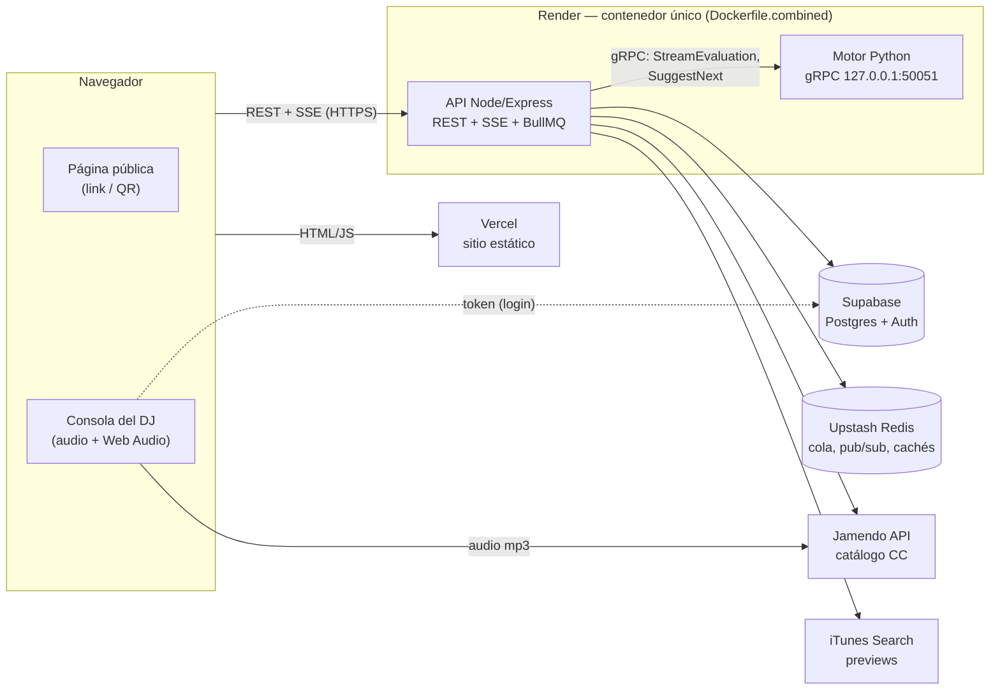

# SmartDJ — backend y motor de IA

SmartDJ convierte el link o el QR de un local (bar, café, restaurante, discoteca) en una **emisora que no se detiene**:
- **Público:** pide canciones desde su celular sin cuenta. Un motor de IA evalúa en vivo si cada canción encaja con lo que suena.
- **Dueño:** maneja la emisora desde una consola de DJ en el navegador. El AutoDJ elige la siguiente pista con el mismo motor.

Este repositorio tiene la API (Node/Express), el motor de compatibilidad (Python, gRPC), el esquema de la base de datos y las pruebas, incluida la de carga. El frontend estático está en [`smartdj-frontend`](https://github.com/Pipemora1324/smartdj-frontend).

## Arquitectura



| Pieza | Dónde | Qué hace |
| --- | --- | --- |
| Frontend | Vercel | Sitio estático: página pública, panel y consola del DJ. Ver su repositorio. |
| API (`backend/`) | Render | REST y SSE; valida los tokens de Supabase; cola de evaluación (BullMQ); emisora y AutoDJ; catálogo (Jamendo, iTunes y, opcional, Audius). |
| Motor (`ai/`) | Render, mismo contenedor | Compatibilidad musical por heurísticas (género, BPM, tonalidad Camelot, ambiente del local) y elección de la siguiente pista. gRPC interno; también HTTP para desarrollo. |
| Base de datos | Supabase | Postgres (locales, peticiones, emisora, caché de metadatos) y Supabase Auth (registro, códigos y sesión). |
| Redis | Upstash | Cola BullMQ, avisos en vivo (pub/sub), estado de cada petición, caché de búsquedas de iTunes y tope mensual de Jamendo. |
| Gateway (`gateway/`) | Solo en local | Nginx delante de la API en `docker compose` (puerto 8080). |

## Flujos principales

**Petición del público** (sin cuenta):
1. Busca una canción. Primero aparecen pistas **completas** de Jamendo; si hay menos de 5, se completan con **previews de 30 s** de iTunes.
2. `POST /api/public/venues/:code/requests` guarda la petición y la encola en BullMQ.
3. El worker la manda al motor por gRPC (`StreamEvaluation`). Cada etapa (género, BPM, tonalidad, resultado) se publica en Redis y llega al navegador por SSE (`GET /api/public/requests/:id/events`), o por polling si el SSE falla.
4. El motor compara contra lo que suena en la emisora o, si está detenida, contra el ambiente del local.
5. En **AutoDJ**, si encaja, se intercala sola en la cola usando su versión completa en Jamendo o, si no existe, el corte de 30 s.
6. Si no encaja, decide el dueño desde la consola.

```
 Navegador                 API (Node)                               Motor (Python)
 POST .../requests  ─▶  guarda y encola (BullMQ)
                         worker ── StreamEvaluation (gRPC) ──────▶  QUEUED
                                ◀─ un evento por etapa ───────────  ANALYZING_GENRE / BPM / KEY
 SSE .../events     ◀─  publica cada etapa en Redis                 RESULT
                         guarda el resultado en Postgres; si encaja, AutoDJ la intercala
```

**Emisora del dueño** (consola, con sesión de Supabase):
- La consola reproduce el audio de Jamendo en el navegador, con dos decks, crossfade y EQ.
- El servidor guarda el estado (`player_state`) y la cola (`play_queue`).
- Al avanzar, saltar o quitar una pista, el AutoDJ (`autodj.js`) rellena la cola hasta 5 pistas: toma candidatas del caché o de Jamendo y le pide la mejor al motor (`SuggestNext`).
- Solo se ejecuta por eventos, nunca con temporizadores.
- **Respaldos:**
  - Si el motor falla, elige por género y energía del local.
  - Si Jamendo falla, usa el caché.
  - Si no hay caché, usa la pista que suena en la radio de Jamendo.
- La página pública se entera de los cambios por el SSE del local (`GET /api/public/venues/:code/events`). Hay un solo suscriptor de Redis por proceso y los avisos se agrupan: como mucho uno cada 2 s.

Las decisiones de diseño están en [DECISIONES_DJ.md](DECISIONES_DJ.md) (emisora, Jamendo, AutoDJ) y [DECISIONES_GRPC.md](DECISIONES_GRPC.md) (gRPC y despliegue).

## API

Todas las respuestas de error son `{ "error": "<mensaje en español>", "code": "<código estable>" }`. Los códigos son `invalid_input`, `unauthorized`, `forbidden`, `not_found`, `conflict`, `payload_too_large`, `rate_limited`, `upstream_error`, `unavailable`, `upstream_timeout`, `internal` y algunos específicos como `console_taken` y `EMAIL_NOT_VERIFIED`.

**Públicas** (sin cuenta; límites por cliente y tope por IP, ver [CARGA.md](CARGA.md)):

| Ruta | Uso |
| --- | --- |
| `GET /api/health` | Estado del servicio |
| `GET /api/public/venues/:code` | Datos del local |
| `GET /api/public/venues/:code/now` | Lo que suena y la cola, sin datos de clientes |
| `GET /api/public/venues/:code/search?q=` | Buscador (Jamendo + iTunes) |
| `POST /api/public/venues/:code/requests` | Pedir una canción: `{trackId}` de iTunes o `{provider:'jamendo', externalId}` |
| `GET /api/public/venues/:code/requests?ids=` | Estado de las peticiones propias |
| `GET /api/public/requests/:id` y `/events` | Estado en vivo de una petición (polling y SSE) |
| `GET /api/public/venues/:code/events` | Avisos del local (SSE). `?view=console` para la consola |

**Del dueño** (`Authorization: Bearer <token de Supabase>`; un local ajeno responde 404):

| Ruta | Uso |
| --- | --- |
| `GET /api/auth/me` | Perfil. La primera vez crea la fila en `users` si el correo está confirmado |
| `GET/POST /api/venues`, `PATCH /api/venues/:id` | Locales del dueño |
| `GET /api/venues/:id/tracks/search?q=&genre=&provider=` | Catálogo de la emisora (Jamendo; Audius si está configurado) |
| `GET/PATCH /api/venues/:id/player` | Estado de la emisora; volumen, modo (`autodj`/`manual`) y crossfade |
| `POST .../player/claim`, `/play`, `/pause`, `/skip`, `/advance` | Control de la emisora (una sola consola a la vez; `advance` es idempotente) |
| `POST/PATCH .../player/queue`, `DELETE .../player/queue/:itemId` | Agregar, reordenar y quitar de la cola |
| `GET .../player/requests`, `POST .../requests/:id/queue`, `/dismiss` | Peticiones pendientes: ponerlas en la cola o descartarlas |

## Ejecutar en local

Requiere Docker con Docker Compose.

1. Copia `.env.example` como `.env` y cambia los valores `CAMBIAR_ESTO`.
2. `docker compose up --build`
3. Comprueba que responde: `http://localhost:3000/api/health`. También está el gateway en `:8080`.

| Puerto | Servicio |
| --- | --- |
| 3000 | API |
| 8080 | Gateway Nginx (`/api/`) |
| 50051 | gRPC del motor (publicado en local para `backend/scripts/grpc-smoke.mjs`) |

**Migraciones** (`database/migrations/`, se pueden ejecutar más de una vez):
- **En Docker local** se aplican solas al crear el volumen de Postgres.
- **En Supabase** se pegan en orden (001 a 008) en el SQL Editor.
- La **009** (`009_limpieza_opcional.sql`) borra tablas y columnas de la autenticación anterior. Es **opcional** y está pensada para **ejecutarla a mano solo tras confirmar** que no se usan. No se monta en ningún compose.

## Variables de entorno

Al arrancar, `backend/src/config.js` valida todas las variables. Si falta alguna o tiene mal formato, el servidor no arranca y lista **todos** los problemas en español.

| Variable | Obligatoria | Uso |
| --- | --- | --- |
| `DATABASE_URL` | Sí | `postgres://` o `postgresql://` (en Supabase, la del pooler) |
| `DATABASE_POOL_MAX` | No (10) | Conexiones del pool, máximo 50 |
| `REDIS_URL` | Sí | `redis://` o `rediss://`. Las URLs de Upstash copiadas como `redis://` se pasan a TLS solas |
| `SUPABASE_URL` | Sí | `https://<ref>.supabase.co`; valida el emisor de los tokens |
| `SUPABASE_JWKS_URL` | Sí (o el secreto) | Claves públicas para validar los tokens (RS256/ES256) |
| `SUPABASE_JWT_SECRET` | No | Solo si el proyecto usa el secreto HS256 heredado (al menos 32 caracteres). Es secreto: solo en Render |
| `AI_SERVICE_URL` | Sí | URL HTTP del motor (respaldo si no hay gRPC) |
| `AI_GRPC_URL`, `AI_GRPC_TLS` | No | `host:puerto` del motor por gRPC. El contenedor combinado ya lo define |
| `AI_GRPC_TIMEOUT_MS`, `AI_GRPC_CONNECT_TIMEOUT_MS` | No (10000 / 3000) | Plazos del cliente gRPC |
| `CORS_ORIGIN` | No | Orígenes extra del frontend, separados por coma. Los de Vercel y localhost ya están permitidos |
| `JAMENDO_CLIENT_ID` | Para la emisora | Client ID de [Jamendo](https://devportal.jamendo.com). Sin él, el catálogo avisa que no está configurado |
| `JAMENDO_MONTHLY_BUDGET` | No (30000) | Tope de consultas a Jamendo por mes; al llegar se usa solo el caché |
| `AUDIUS_API_KEY` | No | Segundo proveedor, opcional. Solo en el servidor |
| `LOG_LEVEL` | No (info) | `debug`, `info`, `warn`, `error` o `silent` |
| `MUSIC_SEARCH_COUNTRY` | No (CO) | País de la tienda de iTunes |
| `JAMENDO_API_URL`, `ITUNES_API_URL` | No | Solo para pruebas con dobles locales (https, o http en localhost) |
| `AI_GRPC_PORT`, `AI_HTTP_PORT`, `AI_BIND_HOST`, `AI_STREAM_STEP_DELAY_MS` | No | Del motor; el contenedor combinado ya las define |

Los registros son JSON, una línea por evento. Las claves con datos personales o secretos (correo, nombre, token…) se ocultan siempre.

## Pruebas

```bash
cd backend
npm install
npm test           # unitarias + motor (Python, en Docker) + integración (Postgres y Redis efímeros en Docker)
npm run coverage   # lo mismo con cobertura (c8)
npm run lint       # ESLint
npm run format     # Prettier (format:check solo revisa)
```

`npm test` corre todo en orden y necesita Docker:
- **Unitarias:** validaciones, límites de uso, lógica del reproductor y del catálogo, proveedores, cliente gRPC (reintentos, plazos y errores), configuración y logger.
- **Motor:** se prueba dentro de su propia imagen (`ai/tests`): compatibilidad, AutoDJ y servidor gRPC.
- **Integración** (`backend/test/integration`):
  - Levanta Postgres y Redis efímeros (`docker compose`, datos en tmpfs) y monta la API real.
  - Usa dobles locales de Supabase (JWKS con clave generada en la prueba), Jamendo, iTunes y el motor gRPC.
  - Cubre sesión y propiedad, catálogo y cuota, reproductor y AutoDJ con sus respaldos, peticiones de punta a punta (cola, SSE, panel del dueño) y límites.
  - **Nunca toca producción ni el Supabase real.**
- `SKIP_ENGINE=1` y `SKIP_INTEGRATION=1` omiten esos pasos.
- Si ya hay un Postgres y un Redis de prueba, `TEST_DATABASE_URL` y `TEST_REDIS_URL` evitan levantar contenedores.

**Cobertura** (líneas, con `c8 --all`, contando también los archivos que ninguna prueba carga):

| | Antes | Ahora |
| --- | --- | --- |
| Backend | 39 % | 94 % (ramas 82 %) |
| Motor | 89 % | 89 % (`autodj.py` 99 %, `engine.py` 96 %) |

**Prueba de carga:** `load/`, solo local. Resultados y límites de los planes gratis en [CARGA.md](CARGA.md).

## Despliegue

**Render** (servicio web Docker):
- **Root Directory:** vacío.
- **Dockerfile Path:** `./Dockerfile.combined`.

El contenedor arranca el motor (gRPC y HTTP solo en `127.0.0.1`) y después la API en `$PORT`. Si uno de los dos muere, el contenedor sale y Render lo reinicia. Usa unos 100 MiB de los 512 MB.

**Variables en Render:** `DATABASE_URL`, `REDIS_URL`, `SUPABASE_URL`, `SUPABASE_JWKS_URL` y `JAMENDO_CLIENT_ID`. Opcionales: `CORS_ORIGIN`, `DATABASE_POOL_MAX` y `JAMENDO_MONTHLY_BUDGET`.

**Supabase:**
- Migraciones 001–008 en el SQL Editor (la 009 es opcional).
- Auth configurado según [SUPABASE_AUTH.md](SUPABASE_AUTH.md).

**Upstash:** una base Redis; su URL va en `REDIS_URL`.

**Vercel:** ver el README del frontend.

**Antes de una demo:**
- Render gratis duerme el servicio tras 15 minutos sin tráfico y tarda cerca de un minuto en despertar: abre la página unos minutos antes.
- Con 0,1 CPU, 150 personas a la vez funcionan sin errores pero lento (ver [CARGA.md](CARGA.md)).

**Calidad:** SonarCloud analiza ambos repositorios. Las dependencias van fijadas (`package-lock.json`; `ai/requirements.lock` con hashes y `--require-hashes`). Los contenedores corren sin root. `npm audit` y `pip-audit` están sin vulnerabilidades conocidas.

Para regenerar el lock de Python:

```bash
docker run --rm -v "$PWD/ai:/work" -w /work python:3.12-slim sh -c "pip install pip-tools==7.4.1 && pip-compile --generate-hashes --allow-unsafe --strip-extras -o requirements.lock requirements.txt"
```

## Licencias

- **Código:** proyecto académico. No tiene una licencia de software publicada; consulta al autor antes de reutilizarlo. Las dependencias conservan sus propias licencias (MIT, Apache-2.0, BSD).
- **Música de Jamendo:**
  - La API es gratuita **solo para uso no comercial**.
  - Hay que dar crédito al artista y a Jamendo y enlazar cada pista a su página. SmartDJ lo muestra en la consola y en la página pública.
  - Solo se guardan metadatos durante 24 h, nunca audio, porque los términos prohíben diseñar la app para cachear contenido.
  - Cada pista tiene su licencia Creative Commons. Las `NC` quedan marcadas y cada local puede excluirlas ("Solo licencias comerciales").
- **Audius:** sus pistas se tratan como no comerciales porque la licencia viene vacía.
- **Previews de iTunes:** los términos los permiten solo para promocionar la tienda, con atribución y enlace.
  - Usarlos como "corte de petición" en la emisora se hizo por pedido del proyecto académico, con atribución y enlace.
  - **Para un uso real hay que quitarlo.**
- **Uso comercial real:** poner música en un local abierto al público es un uso comercial y una comunicación pública. Hace falta:
  - Una licencia comercial de Jamendo (Jamendo Licensing, radios "In-Store").
  - Revisar la gestión colectiva; en Colombia, SAYCO-ACINPRO.
  - Esto no es asesoría legal.
